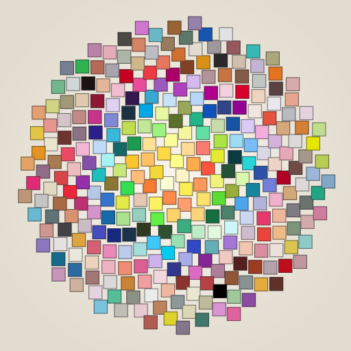

# Pixel Bead / 像素豆

<p align="center">
  
</p>

> 一颗一色，拼出世界。

Minecraft 像素拼豆创作模组：**291 色 MARD 拼豆方块**、把普通方块批量转换为拼豆的
**拼豆染色工作台**，以及服务端权威的**拼豆建造模式**（18 槽虚拟色带 + 完整颜色选择器）。

| 项目 | 值 |
|---|---|
| 中文名称 | 像素豆 |
| 英文名称 | Pixel Bead |
| 宣传语 | 一颗一色，拼出世界。 |
| 项目描述 | Minecraft 像素拼豆创作模组 |
| 吉祥物 | 白色小狗 |
| Mod ID | `pixelbead` |
| Git 仓库 | `pixel-bead` — <https://github.com/mahoo12138/pixel-bead> |
| 当前版本 | `0.1.0-rc.1` |
| 许可证 | 代码 MIT（[LICENSE](LICENSE)）；第三方素材与图标来源见 [NOTICE.md](NOTICE.md) |
| 运行环境 | Minecraft 26.3 · NeoForge 26.3.0.99+ · Kotlin for Forge 6.5.0+ · Java 25 |

- **Minecraft** 26.3 · **NeoForge** 26.3.0.99 · **Kotlin** 2.4.21 (via Kotlin for Forge 6.5.0)
- **ModDevGradle** 2.0.148 · **Gradle** 9.9.1 · **Java** 25
- modId `pixelbead`, package `com.pixelbead`

设计见 [SPEC.md](SPEC.md) 与 [PLAN.md](PLAN.md)，色彩数据署名见
[color-data/NOTICE.md](color-data/NOTICE.md)，发布说明见 [CHANGELOG.md](CHANGELOG.md)，
各平台字段映射见 [PUBLISHING.md](PUBLISHING.md)。

> 下文验证日志记录的是 `0.1.0` 开发构建；当前发布版本为 `0.1.0-rc.1`，modId 与存档格式未变。

## Build & run

Requires network access to `maven.neoforged.net` (use a proxy/VPN if it is blocked). The Java 25
toolchain is auto-provisioned by the foojay resolver.

```bash
./gradlew build        # generate resources + compile + test + jar
./gradlew runClient    # launch a dev client
./gradlew runServer    # launch a dev dedicated server
```

> If the JVM does not pick up the system proxy, pass it to Gradle explicitly (no build-file
> changes needed):
> `GRADLE_OPTS="-Dhttps.proxyHost=127.0.0.1 -Dhttps.proxyPort=7890 -Dhttp.proxyHost=127.0.0.1 -Dhttp.proxyPort=7890" ./gradlew build`
> With that proxy the standard repository config resolves everything, including
> `neoform-runtime`, and ModDevGradle decompiles the 26.3 sources locally.

> The dev runs pass `-Dneoforge.warnings.logofile.hide=true` (see `build.gradle.kts`): KFF 6.5.0
> still declares the deprecated `logoFile` key, which makes NeoForge 26.3 show a dev-only
> "Warning while loading mods" screen. This suppresses just that one warning; real loading
> issues are still reported, and production builds never show it.

## What is implemented

- **Palette** (`palette/`): build-time CSV→JSON pipeline (`generateBeadResources` in `build.gradle.kts`)
  with hard validation (291 colors, exact per-series counts). Single source of truth read at runtime.
  Data-driven dye→series map (`data/pixelbead/pixelbead/dye_series_map.json`, datapack-overridable).
- **Blocks/items** (`blocks/`): 291 bead blocks + BlockItems, uniform properties, one shared white
  texture + cube model, color via `BlockTintSource`/`ItemTintSource`. Creative tab in series/code order.
- **Workbench** (`workbench/`): block + transient menu + screen, 16 blocks + 1 dye → 16 beads,
  input filtering (containers/BlockEntity/blacklist/whitelist), consume-on-take with re-validation.
- **Bead mode** (`beadmode/`, `inventory/`, `network/`): synced+serialized player attachment (no
  copyOnDeath), precise flight grant/restore, full interaction interception, placement through the
  vanilla BlockItem pipeline (claim-compatible, no client coordinates), survival consumption, cleanup
  on death/teleport/dimension/logout/gamemode/config. Admin command `/pixelbead enable|disable|status`.
- **Client UI** (`client/`): rebindable keys, an 18-slot (2 rows × 9) virtual hotbar decoupled
  from the real inventory, HUD layer, full color picker (series nav / search / favorites /
  recents / assign) with a bottom-flush mirrored hotbar, workbench screen.
- **Config** (`config/`): server + client `ModConfigSpec`.
- **Tests**: `PaletteTest`, `WorkbenchLogicTest` (pure logic) and `ResourceSchemaTest` (shipped
  datapack/asset JSON schema regression).

## Status / verification

The whole codebase now **compiles, tests and packages** against the real Minecraft 26.3 /
NeoForge 26.3.0.99 artifacts. `./gradlew build` succeeds with the configuration cache enabled
(`generateBeadResources` → 291 colors / 15 series, `compileKotlin`, 20 passing tests, `jar`). The first real
build decompiled 7301 Minecraft sources locally
(`build/moddev/artifacts/minecraft-patched-26.3.0.99-sources.jar`), so every `NOTE: verify against
26.3 source` marker was checked against actual 26.3 code and removed. Corrections made:

- `ModConfig.Type.SERVER` no longer exists → `SYNCED`; commands use the new
  `PermissionSet` / `Permissions.COMMANDS_GAMEMASTER` model instead of `hasPermission(2)`.
- `TriState` → `net.minecraft.util.TriState`; `ClientPlayNetworking` →
  `ClientPacketDistributor.sendToServer`; clientbound handlers moved to
  `RegisterClientPayloadHandlersEvent` so a dedicated server never loads client classes.
- `DeferredRegister.createBlocks/createItems` (constructors are now protected); explicit
  `Supplier<Properties>` for `registerBlock`; `RecordCodecBuilder.mapCodec` for attachments.
- RenderPearl: `GuiGraphicsExtractor.text/centeredText`, `mouseClicked(MouseButtonEvent, boolean)`,
  `VanillaGuiLayers.HOTBAR` confirmed; `Minecraft.gui.screen()/setScreen()`.
- SDL input: `InputConstants.Type.KEYBOARD`, `InputEvent.Key.getKey()` + `PRESS`,
  `Inventory.get/setSelectedSlot`; `KeyMapping.Category` is now a record.
- `SimpleContainer.addListener` removed → override `setChanged()`; `placeItemBackInInventory`
  needs `Prediction.SERVER_ONLY`; `SimpleContainer` lives in `net.minecraft.world`.
- Placement now goes through `ItemStack.useOn` (not `BlockItem.useOn`) — the only path firing
  `BlockEvent.EntityPlaceEvent` for claim mods; a reentrancy guard stops the blanket
  `UseItemOnBlockEvent` gate from vetoing our own placement.
- `ItemTintSource.type()` must return the exact registered `MapCodec` instance; the generated
  item-model `tints[].type` dispatch schema was checked against vanilla 26.3 assets.
- Datapack reload ids need the `.json` extension; `generateBeadResources` is now a standalone
  `Action<Task>` so Gradle 9's configuration cache can serialize it.
- `AddServerReloadListenersEvent` is a **game bus** event (`AddClientReloadListenersEvent` is mod
  bus); registering it on the mod bus crashes a dedicated server with "not valid for this bus".
- 26.3 datapack schemas differ from 1.21.x: shaped-recipe ingredients are plain strings
  (`"P": "#minecraft:planks"`, not `{"tag": ...}`), and `LootPool` uses a singular
  `"condition": { "type": "minecraft:survives_explosion" }` object, not a `"conditions"` array.
  Both the static workbench files and the 291 generated loot tables were corrected against
  vanilla 26.3 data; `ResourceSchemaTest` locks this in.

A **dedicated-server smoke test** (`./gradlew runServer`, with `eula=true` in `run/eula.txt`) also
passes: the mod list contains `Pixel Bead 0.1.0`, startup logs `Pixel Bead: loaded 291 MARD
colors`, the world is generated and the server reaches `Done (1.859s)! For help, type "help"`.
`run/logs/latest.log` has zero `ERROR`/`FATAL`/datapack parse failures; the remaining warnings are
only vanilla command ambiguities and the offline-mode notice.
(`runServer` is a long-lived task — terminating it manually makes Gradle report a non-zero exit,
which is not a mod failure.)

A **client bootstrap smoke test** (`./gradlew runClient`) also passes: the dev client (user `Dev`,
OpenGL/LWJGL 3.4.3, SDL video) loads `Pixel Bead 0.1.0`, logs `Pixel Bead: loaded 291 MARD
colors`, completes the first resource reload with `mod/pixelbead` in the pack list, builds every
texture atlas and reaches the menu with zero `ERROR`/`FATAL` and no new crash report. This
exercises the client-only registration chain (tint sources, key mappings, GUI layers, menu
screens, clientbound payload handlers). Logs are kept at `build/server-smoke-latest.log` and
`build/client-smoke-latest.log` (both are git-ignored). A fresh run after the warning fix has
**zero loading warnings** — no `logoFile` line, no `Mods loaded with N warning(s)` — and goes
straight to the main menu.

Remaining work is **visual / interactive in-game verification** (a headless smoke test cannot
cover it): colour and tint consistency in a world, HUD and picker layout, key rebinding, workbench
GUI, and the full interaction / death / dimension / logout cleanup matrix.

**In-game bug found & fixed (2026-11-15):** entering bead mode made *both* mouse buttons inert.
`BeadKeyHandler` cancelled `InteractionKeyMappingTriggered` for attack/use, and 26.3's
`Minecraft.startAttack()` / `startUseItem()` return immediately when that event is cancelled
(`continueAttack()` short-circuits too) — so no `START_DESTROY_BLOCK` and no
`ServerboundUseItemOnPacket` ever left the client, and the server-side `RightClickBlock` /
`BreakBlockEvent` chain (hence `BeadPlacement.place()`) never ran. Only middle-click is blocked
now; all filtering is server-side. Placement rejections now show a concrete HUD reason instead of
failing silently. **Restart `runClient` to pick up the rebuilt classes.** One behaviour is
intentional per design §6.5: in survival a right-click without the selected bead in inventory is
refused with an "insufficient" toast — test in creative mode first.

**Breaking is unrestricted (2026-11-15, setting change):** bead mode no longer blocks mining
non-bead blocks. `LeftClickBlock`, `BreakBlockEvent` and `BreakSpeed` interceptors were removed
from `BeadModeEvents`, so left-click mines beads and ordinary blocks alike at vanilla speed and
with vanilla drops. Only *placement* (always a bead) and *use* (chests, doors, buckets, food, …)
are still restricted.

**HUD / picker UX (2026-11-15):** the virtual hotbar is now **18 slots in two rows** — `1-9`
for the first row, `Shift+1-9` for the second, scroll cycles all 18. Both the in-game HUD and
the picker are drawn by one shared renderer (`BeadHotbarView`), and the picker shows a mirrored
copy of the hotbar. Old 9-slot saves are normalised on read. The selected-slot highlight is a
two-tone **outline** instead of an opaque white rectangle, so the underlying color stays visible;
the dark ring fills the 1px channel and the colored ring is drawn *inside* the swatch edge, which
keeps neighbours untouched.

**Bead-mode visuals & picker flow (2026-11-15):** while bead mode is active the whole vanilla
bottom HUD is hidden via `RenderGuiLayerEvent.Pre` — item bar, held-item name, health/armor/
food/air/vehicle bars and the experience bar/level (crosshair, effects, chat and boss bar stay).
With that space free the mod HUD sits **2px from the window bottom** (`BOTTOM_GAP`), and the
swatches are separated by a single 1px channel (`GAP`) so the bar reads as one tight color strip
instead of a loose grid. The picker's mirrored bar uses the exact same placement rule, so it is
equally flush with the bottom edge. The first-person hand
shows the selected bead: `BeadFirstPersonView` overrides the 26.3 first-person render state
(never the real inventory), so the virtual hotbar stays decoupled and a dedicated server sees
no change.

The picker flow is **slot first, color second**: click a slot to target it (gold cursor), then
click colors to write them — each click fills that slot and advances the cursor to the next one
(wrapping at 18), backed by a local optimistic hotbar copy so consecutive clicks feel instant.

**HUD docking (2026-11-15):** the bar can be docked to the **bottom** (9 × 2, the default) or to
either **side** (a single column of 18, flush with that edge and vertically centered; if the window
is too short for 305px it falls back to two columns of 9). The setting is
`ClientConfig.hudPosition` (`hud.position` in `pixelbead-client.toml`) and is edited on a
vanilla-styled settings screen (`PixelBeadOptionsScreen`: `OptionsSubScreen` + `OptionsList` +
`CycleButton`), reachable from the **Settings** button in the picker's top-right corner (same row and
same height as the search box, `SEARCH_Y`/`SEARCH_H`/`SEARCH_W` are shared constants so the two can
never drift apart) and from **Mods → Pixel Bead → Config**. The picker's own mirrored bar always
stays at the bottom: it is the editing surface.
Swatches come in three sizes — **small** (12px), **medium** (16px, the default) and **large**
(20px) — set by `ClientConfig.hudSwatchSize` (`hud.swatch_size`). The 1px channel between swatches
is constant, so every step still reads as one tight color strip, and the picker's mirrored bar
uses the same size as the HUD.
While the picker or the settings screen is open the in-game HUD is hidden and the two surfaces are
fully independent: there is no shared preview state or HUD/picker linkage to keep in sync.

**First join (2026-11-15):** the first time a player joins a world, `WelcomeMessage` posts two chat
lines — a greeting and a hint that renders the *actual* bound keys through `Component.keybind`
(`key.pixelbead.toggle_mode` / `key.pixelbead.open_picker`), so rebinding never makes the text lie.
The "already greeted" flag is its own attachment (`BeadModeAttachments.WELCOMED`: a `Boolean` with
`copyOnDeath`, never synced) rather than a field of `BeadModeState`, because that state is
deliberately not copied on death — otherwise dying and relogging would replay the greeting.
It is skipped (and not consumed) when the server config disables the feature.

## Bead tools (2026-11-15, redesigned)

Two independent layers, both server-authoritative and both behind `tool.enabled`.

**Always on (bead mode):**

| Gesture | What happens |
|---|---|
| Hold RMB and sweep | **Stroke**: the cells the cursor skipped are filled with a line, so dragging fast no longer leaves gaps. Bridged only within one face plane and `tool.max_stroke_gap` blocks; a pause (500 ms) or a face change breaks the stroke |
| Plain LMB on a bead block | **Eraser**: that bead disappears instantly, and the sweep is interpolated exactly like the brush |
| `Z` | **Undo** the last stroke / fast-mode operation (`tool.undo_steps`, default 8) |

**Fast mode — hold `~` (creative only, for now):** a shape is built from **two points**. The first
click places a bead (place modes) and marks the point, the second click closes the shape and applies
it to everything in between. `↑` / `↓` cycle the four modes while the key is held; the HUD shows the
current one.

| Mode | Shape |
|---|---|
| 线性放置 / line place | one diagonal line of beads between the two points |
| 线性消除 / line erase | the same line, removed |
| 平面放置 / plane place | the rectangle spanned by the two points (they must share one plane, otherwise nothing happens and the HUD says so) |
| 平面消除 / plane erase | the same rectangle, removed |

Placement only ever creates bead blocks; erasing removes **any** block. Shapes are capped by
`tool.max_area` (512). Survival is intentionally unsupported: holding `~` there only prints a hint.

Why it is built like this:

- **No coordinate payloads.** Both marks come from ordinary right clicks, so the server derives
  every cell from events it already receives. Each filled cell still runs through
  `BeadPlacement.placeAt` → `ItemStack.useOn` → `EntityPlaceEvent`, so claim mods keep vetoing cell
  by cell. The payloads are a boolean (tool key held) and one small int (selected mode).
- **Erasing goes through `ServerPlayerGameMode.destroyBlock`**, so `BreakEvent` still fires and claim
  mods can refuse it — the bulk path is not a back door around protection.
- **Everything is undoable**, including erasing arbitrary blocks: the previous block state of each
  cell is stored, and undo puts it back.
- **Nothing is persisted.** Tool/key/mode/mark/stroke/undo state lives in `ToolSessions`, a
  per-player map dropped on logout, death, teleport and dimension change, so a stale "tool key held"
  flag can never survive a crash.

## Licensing & credits

- **代码 / 构建脚本 / 资源生成器**：MIT，© 2026 mahoo12138 — 全文见 [LICENSE](LICENSE)。
- **MARD 291 色彩数据**：MIT，© 2026 MakeBead (<https://makebead.com>)，从
  `makebead/craft-color-codes` 的 `data/csv/mard-291.csv` 原样引入。HEX/RGB 是屏幕参考值，
  不是厂商实测值。见 [color-data/LICENSE](color-data/LICENSE) 与
  [color-data/NOTICE.md](color-data/NOTICE.md)。
- **图标**：`assets/pixelbead/icon.png` 由 `tools/make_icon.py` 从同一份 MARD 色卡计算生成
  （291 颗色块的黄金角螺旋，暖纸底 + 自带描边），只依赖 Python 标准库，可逐像素复现；
  项目不含第三方图像素材。见 [NOTICE.md](NOTICE.md) 第 4 节。
- **Minecraft / NeoForge / Kotlin for Forge**：独立社区模组，与 Mojang Studios、Microsoft、
  NeoForged 无隶属或背书关系；相关商标归各自权利人所有。